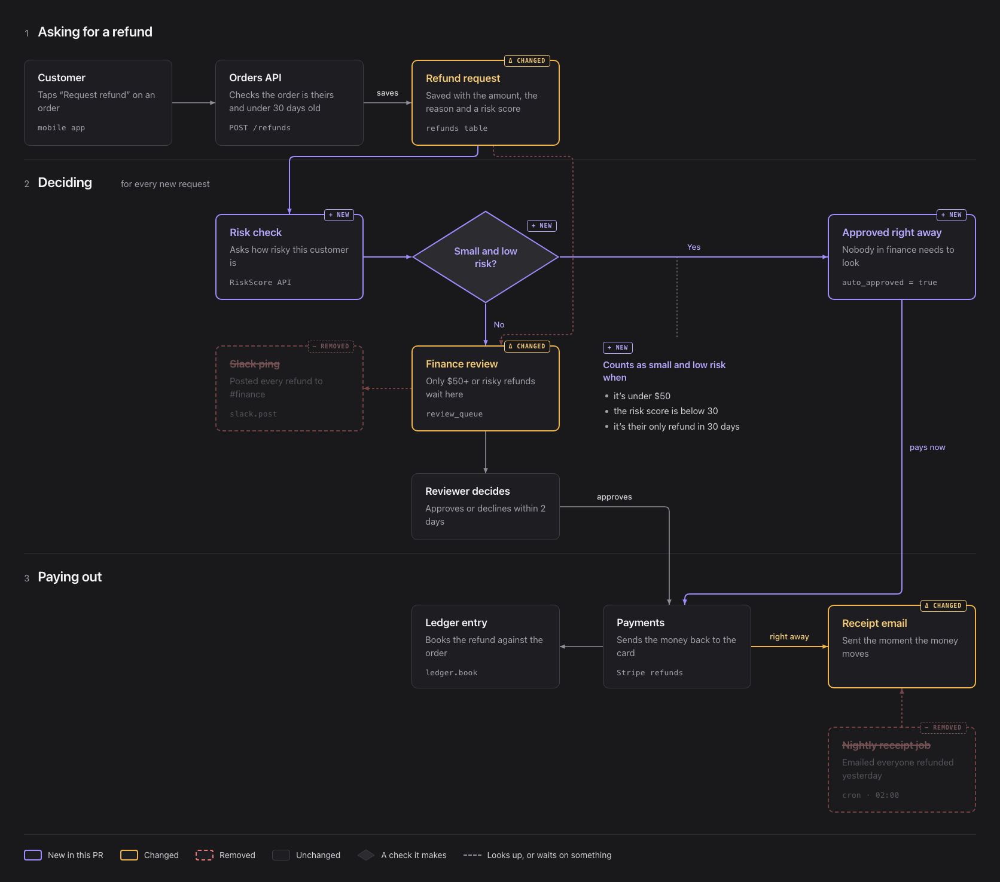
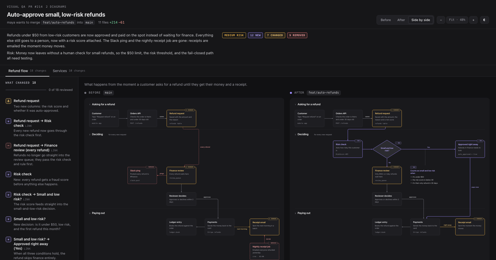
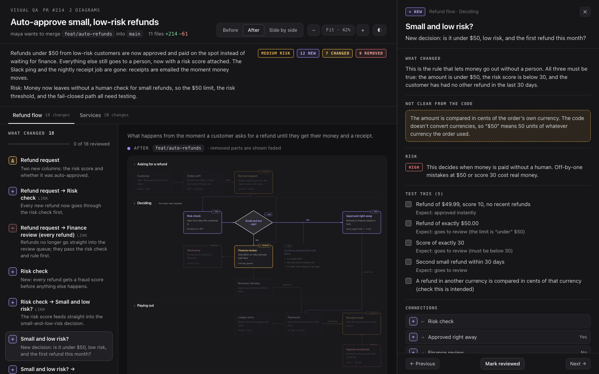
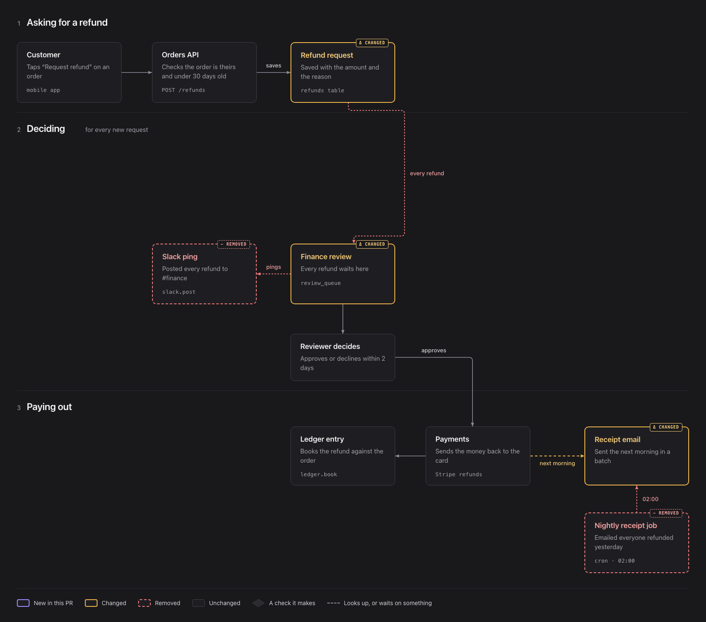
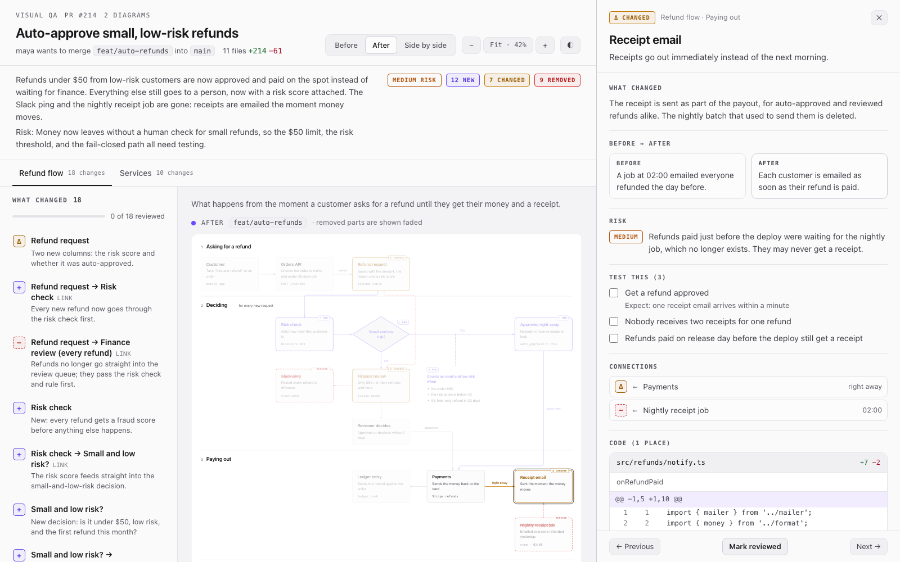
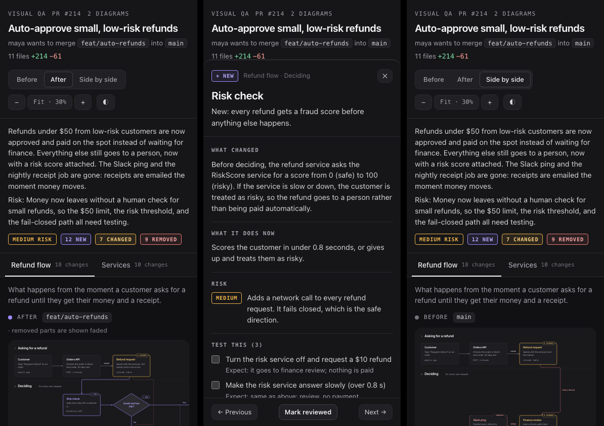

# Visual QA

**Before/after diagrams for every pull request.** See exactly what a PR changes in your app's architecture or logic. Every new, changed, or removed part is highlighted, and clicking it shows the code lines behind it and the QA checks to run before you merge.

A diff shows lines. A reviewer, a QA tester, or a product manager needs to see *behaviour*: which step is new, which check moved, what no longer happens. Visual QA is an agent skill (Claude Code plugin) that reads both sides of a pull request and draws them as the same diagram twice, with the change highlighted.



## What you get

One self-contained HTML file per PR:

- **Before / After / Side by side.** Both states share one layout, so nothing jumps around except what the PR changed. New parts are violet, changed parts amber, and removed parts red and dashed. Each also carries a `+ New` / `Δ Changed` / `− Removed` badge, so colour is never the only cue.
- **Click any changed part** to open what changed in plain words, before → after, how it connects, the **real diff hunks with line numbers** (the lines it points at are highlighted), the QA checks to tick off, and the risk.
- **A change list** with review progress, keyboard navigation (`J`/`K`), and *Copy QA checklist* as Markdown for your PR review.
- **Nothing hides.** Every changed file is either linked to a part of the diagram or listed with a reason ("lockfile", "tests"). Anything else is flagged as *changed, not explained*.
- **Dark and light themes**, phone-friendly, works offline, no tracking.
- **The code is never retyped by the AI.** The agent writes the story and points at file + line ranges; the renderer pulls the actual hunks from git.





## Install

**Claude Code**, from the plugin marketplace:

```text
/plugin marketplace add nd-silva-08/QA-visual
/plugin install visual-qa@qa-visual
```

**Any Agent Skills host** (Cursor, Codex, Gemini CLI, Copilot, …):

```bash
npx skills add nd-silva-08/QA-visual
```

**By hand:** copy `skills/visual-qa/` into `~/.claude/skills/` (or your project's `.claude/skills/`).

Needs git and Node 18+. Chrome or Chromium is optional: it lets the agent render the page, catch layout problems, and look at screenshots of its own diagram before handing it to you.

## Use it

Inside your repository, ask in plain words:

- *"Visual QA PR #214"*
- *"Diagram what my branch changes before I merge"*
- *"Show me a before/after architecture diagram of this PR"*

or call the skill directly: `/visual-qa:visual-qa 214` (plugin install) or `/visual-qa 214` (skills install). With no argument it compares your current branch with the default branch; ask for "including uncommitted changes" to diagram work in progress.

The agent replies with a short summary and the path to `.visual-qa/<name>.html`. Open it in any browser.

## On every pull request (GitHub Actions)

1. Copy [`templates/visual-qa.yml`](templates/visual-qa.yml) to `.github/workflows/visual-qa.yml` in the repository you want reviewed.
2. Add an `ANTHROPIC_API_KEY` repository secret. The workflow uses [anthropics/claude-code-action](https://github.com/anthropics/claude-code-action), which also supports Claude Code OAuth tokens, Amazon Bedrock, Google Vertex AI, and Microsoft Foundry.

Each PR then gets one summary comment (what changed, risks, a QA checklist, unexplained files), updated on every push, with a link to download the interactive report.

## How it works

```
 collect.mjs ──▶ the agent reads both revisions ──▶ spec.json ──▶ render.mjs ──▶ report.html
 (git: exact      (before at the merge-base,        (diagrams,     (validates, pulls real hunks
  commits,         after at the head; plain-         statuses,      from git, checks every changed
  changed lines)   language details, QA checks)      code refs)     file is covered, optional
                                                                    headless-Chrome layout check
                                                                    and screenshots)
```

1. **`collect.mjs`** reads git only. It finds the exact before commit (the merge-base, the same one GitHub diffs against) and the after commit, then prints every changed file with its exact changed lines and the function each change sits in.
2. **The agent** reads the code at each revision separately, decides whether a logic flow or an architecture view tells the story better, and writes a JSON spec: sections, nodes, edges, statuses, plain-language details, QA checks, and code refs (`path` + `lines`).
3. **`render.mjs`** validates the spec, attaches the real diff hunks, checks coverage, and writes the HTML. With `--check` it opens the page in headless Chrome and reports wires crossing boxes, labels covering nodes, and overlaps. With `--screenshot` it saves PNGs the agent looks at to fix its own layout.

The viewer lays out the grid, measures text, and routes every arrow with rounded right-angle bends. Arrows prefer the side facing their target, never pass through boxes or section titles, and spread out where several share a side.

## The scripts work without an AI

```bash
# what changed, and the exact before/after commits
node skills/visual-qa/scripts/collect.mjs --pr 214              # or --base main --head my-branch, or --worktree

# build the report from a hand-written or generated spec
node skills/visual-qa/scripts/render.mjs .visual-qa/spec.json \
  --summary .visual-qa/summary.md --check --screenshot .visual-qa/shot
```

The spec format is documented in [`skills/visual-qa/references/spec-format.md`](skills/visual-qa/references/spec-format.md). [`skills/visual-qa/assets/example-spec.json`](skills/visual-qa/assets/example-spec.json) is a complete two-diagram example.

## Try the demo

Open [`examples/refunds/report.html`](examples/refunds/report.html) in a browser (download it, or clone the repo). It's a made-up pull request that auto-approves small refunds: it adds a risk check and a decision, changes the finance queue, and removes a Slack ping and a nightly email job. [`examples/refunds/summary.md`](examples/refunds/summary.md) is the matching PR comment. Rebuild it with `npm run demo`.

| Before | Light theme | Phone |
|---|---|---|
|  |  |  |

## Privacy

Everything runs on your machine. The report makes no network requests except loading the Inter and IBM Plex Mono fonts from Google Fonts; offline it falls back to system fonts. In CI, the code the agent reads is sent to the model provider you configure in the workflow.

## Development

No dependencies. Node 18+.

```bash
npm test        # unit tests, an end-to-end run against a temporary git repo, and a headless-Chrome check
npm run demo    # rebuild examples/refunds/report.html
```

See [CONTRIBUTING.md](CONTRIBUTING.md).

## Credits

Inspired by Cathryn Lavery's [diagram-design](https://github.com/cathrynlavery/diagram-design) (MIT), especially its *architecture delta* idea: synchronized Before/After topologies with a change ledger. The visual style follows Claude's artifact diagrams. No code was copied from either.

## License

[MIT](LICENSE)
